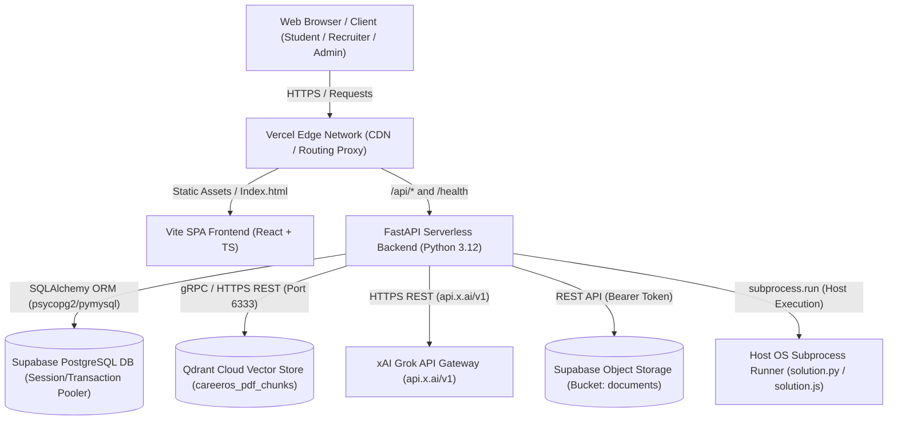

# NEXORA — Autonomous Red Team Security Audit
## Document 02: Attack Surface Map & Architecture Analysis

**Assessment Code:** NEXORA-REDTEAM-001  
**Target:** Nexora Autonomous SaaS Platform (`https://nexoraos.space`)  
**Repository:** `KalpataruDash2005/Nexux`  
**Classification:** Confidential — Security Engineering Documentation  

---

## 1. High-Level Architecture Overview

Nexora is designed as an AI-powered SaaS career and academic operating system. It deploys on Vercel as a polyglot application comprising:
1. **Frontend:** React + TypeScript + Vite single-page application (SPA).
2. **Backend:** Python 3.12 FastAPI application served via Vercel Serverless Python runtime (`api/index.py` -> `app.main:app`).
3. **Database:** Supabase Managed PostgreSQL instance (with connection pooling via transaction pooler on port 6543 / 5432).
4. **Vector Database:** Qdrant Cloud cluster (collection `careeros_pdf_chunks`, 384-dimensional dense vectors with cosine similarity).
5. **AI Provider:** xAI Grok API (`https://api.x.ai/v1`) using workload-based model routing (`grok-2-1212`, `grok-2-mini`, `grok-beta`).
6. **Object Storage:** Supabase Storage (bucket `documents`) and ephemeral serverless filesystem (`/tmp/uploads/pdf`).



---

## 2. Trust Boundaries & Sensitive Data Flows

| Boundary ID | Boundary Description | Trust Transition | Key Risks at Boundary |
| :--- | :--- | :--- | :--- |
| **TB-01** | Client -> Vercel Edge / FastAPI | Untrusted Internet -> Serverless Runtime | Request forgery, parameter tampering, bypass of authentication, injection payloads. |
| **TB-02** | FastAPI -> Host Operating System | Managed Application -> Raw OS Subprocess | Command injection, arbitrary code execution, filesystem traversal, container escape. |
| **TB-03** | FastAPI -> Supabase PostgreSQL | Application Backend -> Relational Database | SQL injection, cross-tenant data access, connection pool exhaustion, missing RLS. |
| **TB-04** | FastAPI -> Qdrant Cloud | Application Backend -> Vector Database | Cross-tenant document retrieval, vector dimension poisoning, metadata leakage. |
| **TB-05** | FastAPI -> xAI Grok Gateway | Application Backend -> Third-Party LLM Provider | Prompt injection (direct & indirect), token quota exhaustion, API key exposure. |
| **TB-06** | Browser -> Browser `localStorage` | Client Memory -> Persistent Web Storage | Plaintext token theft via Cross-Site Scripting (XSS). |

---

## 3. Frontend Route Map

The frontend routing is governed by React Router (`frontend/src/App.tsx`). Routes are divided into public, protected student/recruiter, and administrative views:

| Route | Component | Access Control | Primary Functionality |
| :--- | :--- | :--- | :--- |
| `/` | `LandingPage.tsx` | Public | Marketing landing page, promo videos, feature overviews |
| `/auth` | `Auth.tsx` | Public | User login and registration form |
| `/oauth2/callback` | `OAuth2Callback.tsx` | Public | Handles OAuth redirect, extracts `?token=` parameter |
| `/pricing` | `PricingPage.tsx` | Public | Pricing tiers and feature comparison |
| `/dashboard` | `Dashboard.tsx` | Protected (`token`) | Student main portal, recent workspaces, task metrics |
| `/workspaces` | `WorkspaceList.tsx` | Protected (`token`) | Workspace creation, management, and archiving |
| `/workspaces/:id` | `AcademicWorkspace.tsx` | Protected (`token`) | Academic PDF upload, PDF viewer, multi-turn RAG chat |
| `/tasks` | `Tasks.tsx` | Protected (`token`) | Task kanban/list, AI assistant widget, daily study planner |
| `/placement` | `Placement.tsx` | Protected (`token`) | Interview prep, coding practice, aptitude tests, analytics |
| `/resume` | `ResumeAnalyzer.tsx` | Protected (`token`) | Resume upload, ATS score calculation, career roadmap |
| `/jobs` | `JobBoard.tsx` | Protected (`token`) | Public job board listing active employment postings |
| `/applications` | `JobApplications.tsx` | Protected (`token`) | Application tracking (Student view & Recruiter view) |
| `/profile` | `Profile.tsx` | Protected (`token`) | Student profile editor (education, university, skills) |
| `/admin` | `AdminDashboard.tsx` | Protected (`ADMIN`) | User management, job listings, user feedback, aptitude sets |

---

## 4. Backend API Route Inventory & RBAC Matrix

Mounted in `api/app/main.py` under `/api/v1` (with `/health` at root and `/api/resume/upload` legacy):

| Endpoint | Method | RBAC Requirement | Middleware / Deps | Rate Limited? |
| :--- | :---: | :--- | :--- | :---: |
| **Authentication** | | | | |
| `/api/v1/auth/register` | POST | Anonymous (Public) | None | Yes (20/min) |
| `/api/v1/auth/login` | POST | Anonymous (Public) | None | Yes (30/min) |
| **Health** | | | | |
| `/health`, `/api/v1/health` | GET | Anonymous (Public) | None | No |
| **Student Profile** | | | | |
| `/api/v1/students/me` | GET | Authenticated (`User`) | `get_current_user` | No |
| `/api/v1/students/me` | PUT | Authenticated (`User`) | `get_current_user` | No |
| **Workspaces** | | | | |
| `/api/v1/workspaces` | POST | Authenticated (`User`) | `get_current_user` | No |
| `/api/v1/workspaces` | GET | Authenticated (`User`) | `get_current_user` | No |
| `/api/v1/workspaces/{id}` | GET | Authenticated (`User`) | `get_current_user` | No |
| `/api/v1/workspaces/{id}` | PATCH | Authenticated (`User`) | `get_current_user` | No |
| `/api/v1/workspaces/{id}` | DELETE | Authenticated (`User`) | `get_current_user` | No |
| `/api/v1/workspaces/{id}/archive` | PATCH | Authenticated (`User`) | `get_current_user` | No |
| `/api/v1/workspaces/{id}/stats` | GET | Authenticated (`User`) | `get_current_user` | No |
| `/api/v1/workspaces/{id}/chat` | POST | Authenticated (`User`) | `get_current_user` | No |
| `/api/v1/workspaces/{id}/search` | GET | Authenticated (`User`) | `get_current_user` | **No (BOLA Flaw)** |
| **PDF Assistant & RAG** | | | | |
| `/api/v1/pdf-assistant/workspaces/{id}/documents` | POST | Authenticated (`User`) | `get_current_user` | No |
| `/api/v1/pdf-assistant/workspaces/{id}/documents` | GET | Authenticated (`User`) | `get_current_user` | No |
| `/api/v1/pdf-assistant/workspaces/{id}/documents/{docId}` | GET | Authenticated (`User`) | `get_current_user` | No |
| `/api/v1/pdf-assistant/workspaces/{id}/documents/{docId}/file` | GET | Token or Bearer | `security` / Query param | **No (URL Token)** |
| `/api/v1/pdf-assistant/workspaces/{id}/documents/{docId}/summarize` | POST | Authenticated (`User`) | `get_current_user` | No |
| `/api/v1/pdf-assistant/workspaces/{id}/documents/{docId}` | DELETE | Authenticated (`User`) | `get_current_user` | No |
| `/api/v1/pdf-assistant/workspaces/{id}/documents/{docId}/chat` | POST | Authenticated (`User`) | `get_current_user` | No |
| `/api/v1/pdf-assistant/workspaces/{id}/documents/{docId}/chat/stream` | POST | Authenticated (`User`) | `get_current_user` | No |
| `/api/v1/pdf-assistant/workspaces/{id}/documents/{docId}/diagnostics` | GET | Authenticated (`User`) | `get_current_user` | No |
| `/api/v1/pdf-assistant/internal/result` | POST | Anonymous (Public) | None | No |
| **Placement & Coding Evaluation** | | | | |
| `/api/v1/placement/resume/analyze` | POST | Authenticated (`User`) | `get_current_user` | No |
| `/api/v1/placement/resume/latest` | GET | Authenticated (`User`) | `get_current_user` | No |
| `/api/v1/placement/resumes` | GET | Authenticated (`User`) | `get_current_user` | No |
| `/api/v1/placement/dashboard` | GET | Authenticated (`User`) | `get_current_user` | No |
| `/api/v1/placement/analytics` | GET | Authenticated (`User`) | `get_current_user` | No |
| `/api/v1/placement/readiness` | GET | Authenticated (`User`) | `get_current_user` | No |
| `/api/v1/placement/roadmap` | GET | Authenticated (`User`) | `get_current_user` | No |
| `/api/v1/placement/sessions` | POST / GET | Authenticated (`User`) | `get_current_user` | No |
| `/api/v1/placement/sessions/{id}` | GET | Authenticated (`User`) | `get_current_user` | No |
| `/api/v1/placement/sessions/{id}/start` | POST | Authenticated (`User`) | `get_current_user` | No |
| `/api/v1/placement/sessions/{id}/messages` | POST | Authenticated (`User`) | `get_current_user` | No |
| `/api/v1/placement/sessions/{id}/end` | POST | Authenticated (`User`) | `get_current_user` | No |
| `/api/v1/placement/sessions/{id}` | DELETE | Authenticated (`User`) | `get_current_user` | No |
| `/api/v1/placement/reset` | DELETE | Authenticated (`User`) | `get_current_user` | No |
| `/api/v1/placement/coding` | POST | Authenticated (`User`) | `get_current_user` | No |
| `/api/v1/placement/coding/{id}/run` | POST | Authenticated (`User`) | `get_current_user` | **No (Host RCE)** |
| `/api/v1/placement/coding/{id}/submit` | POST | Authenticated (`User`) | `get_current_user` | No |
| `/api/v1/placement/coding/{id}/submissions` | GET | Authenticated (`User`) | `get_current_user` | No |
| `/api/v1/placement/aptitude` | POST | Authenticated (`User`) | `get_current_user` | No |
| `/api/v1/placement/aptitude/{id}/submit` | POST | Authenticated (`User`) | `get_current_user` | No |
| **Tasks & AI Planner** | | | | |
| `/api/v1/tasks` | POST / GET | Authenticated (`User`) | `get_current_user` | No |
| `/api/v1/tasks/summary` | GET | Authenticated (`User`) | `get_current_user` | No |
| `/api/v1/tasks/ai-plan` | POST | Authenticated (`User`) | `get_current_user` | No |
| `/api/v1/tasks/ai-plan/persist` | POST | Authenticated (`User`) | `get_current_user` | No |
| `/api/v1/tasks/assistant` | POST | Authenticated (`User`) | `get_current_user` | No |
| `/api/v1/tasks/assistant/context` | GET | Authenticated (`User`) | `get_current_user` | No |
| `/api/v1/tasks/assistant/history` | GET | Authenticated (`User`) | `get_current_user` | No |
| `/api/v1/tasks/{id}` | GET / PATCH / DELETE | Authenticated (`User`) | `get_current_user` | No |
| **Jobs & Applications** | | | | |
| `/api/v1/jobs` | GET | Anonymous (Public) | None | No |
| `/api/v1/jobs` | POST | Recruiter or Admin | `get_current_recruiter` | No |
| `/api/v1/applications/me` | GET | Authenticated (`User`) | `get_current_user` | No |
| `/api/v1/applications` | POST | Authenticated (`User`) | `get_current_user` | No |
| `/api/v1/applications/jobs/{jobId}` | GET | Recruiter or Admin | `get_current_recruiter` | **No (BOLA Flaw)** |
| `/api/v1/applications/{id}/status` | PUT | Recruiter or Admin | `get_current_recruiter` | **No (BOLA Flaw)** |
| **Feedback & Notifications** | | | | |
| `/api/v1/feedback` | POST | Anonymous (Public) | None | No |
| `/api/v1/notifications` | POST | Anonymous (Public) | None | No |
| `/api/v1/notifications/pending-work`| POST | Anonymous (Public) | None | No |
| **Admin Operations** | | | | |
| `/api/v1/admin/users` | GET | Administrator | `get_current_admin` | No |
| `/api/v1/admin/jobs` | GET | Administrator | `get_current_admin` | No |
| `/api/v1/admin/feedback` | GET | Administrator | `get_current_admin` | No |
| `/api/v1/admin/feedback/{id}/status` | PATCH | Administrator | `get_current_admin` | No |
| `/api/v1/admin/feedback/{id}` | DELETE | Administrator | `get_current_admin` | No |
| `/api/v1/admin/aptitude/sets` | POST / GET | Administrator | `get_current_admin` | No |
| `/api/v1/admin/aptitude/sets/{setId}/questions` | GET | Administrator | `get_current_admin` | No |
| `/api/v1/admin/aptitude/sets/{setId}` | DELETE | Administrator | `get_current_admin` | No |

---

## 5. Database Schema & Multi-Tenant Entities

The database utilizes standard relational tables managed via SQLAlchemy ORM.

### Entity Relationships & Ownership Map
- `User` (`users`): Root identity entity (`id`, `email`, `password_hash`, `role`).
  - Has 1:1 `StudentProfile` (`user_id`).
  - Has 1:N `Workspace` (`owner_id`).
    - Has 1:N `PdfDocument` (`workspace_id`, `owner_id`).
      - Has 1:N `PdfChatMessage` (`document_id`, `owner_id`).
    - Has 1:N `Document` (`workspace_id`).
    - Has 1:N `Flashcard` (`workspace_id`).
    - Has 1:N `Quiz` (`workspace_id`).
  - Has 1:N `Task` (`user_id`).
  - Has 1:N `PlacementResume` (`owner_id`).
    - Has 1:N `PlacementResumeAnalysis` (`resume_id`, `owner_id`).
  - Has 1:N `PlacementSession` (`owner_id`).
    - Has 1:N `PlacementMessage` (`session_id`, `owner_id`).
  - Has 1:N `Job` (`posted_by_id`).
    - Has 1:N `Application` (`job_id`, `student_id`).
  - Has 1:N `AiConversation` (`user_id`).
  - Has 1:N `AiMemory` (`user_id`).

### Key Isolation Observations
1. **Tenant Separation:** Tenant isolation is implemented purely at the application layer through SQL `WHERE owner_id = :user_id` or `WHERE user_id = :user_id` filters in SQLAlchemy repositories.
2. **Missing Database Level Isolation:** The underlying database (Supabase PostgreSQL) has **zero Row Level Security (RLS)** policies enabled.
3. **Qdrant Vector Isolation:** Points are tagged with payload keys `workspaceId` and `documentId`. Vectors are **NOT** tagged with `ownerId` or `userId`. Vector isolation depends entirely on the application validating workspace ownership before invoking the Qdrant filter.

---

## 6. External Integrations & Data Egress Points

```text
┌────────────────────────────────────────────────────────────────────────┐
│                        NEXORA BACKEND RUNTIME                          │
└──────┬──────────────────┬──────────────────┬──────────────────┬────────┘
       │                  │                  │                  │
       ▼                  ▼                  ▼                  ▼
┌──────────────┐   ┌──────────────┐   ┌──────────────┐   ┌──────────────┐
│ xAI Grok API │   │ Qdrant Cloud │   │   Supabase   │   │ Subprocesses │
│ (api.x.ai)   │   │ (Port 6333)  │   │  (Postgres & │   │ (Python /    │
│              │   │              │   │   Storage)   │   │  Node / C++) │
└──────────────┘   └──────────────┘   └──────────────┘   └──────────────┘
 - System/User      - 384-dim dense    - Relational data  - Student code
   prompts            vectors          - Raw binary PDFs  - Direct OS
 - Extracted PDF    - Document text      (bucket:           execution
   chunks             chunks             documents)       - Outbound
 - Resumes                             - User sessions      network open
```

1. **xAI API (`https://api.x.ai/v1`):** Sends user prompts, extracted document text, and candidate resume texts. API keys are handled server-side via `XAI_API_KEY*` environment variables.
2. **Qdrant Cloud:** Transmits text embeddings and raw text chunks to remote Qdrant cluster. Authenticated via `QDRANT_API_KEY`.
3. **Supabase PostgreSQL & Storage:** Uses connection pooling via `SUPABASE_DATABASE_URL` / `DATABASE_URL` and `requests` calls to `/storage/v1/object/documents/` authenticated via `effective_supabase_key`.
4. **Subprocess Execution Engine:** Executes student code on the host operating system. Has unrestricted network and filesystem access under the host process profile.
