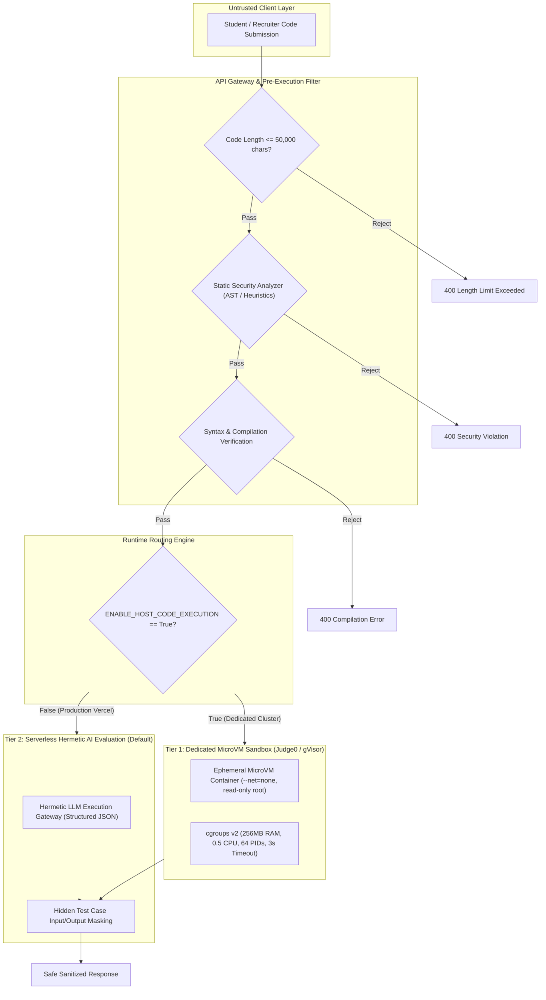

# Nexora — Coding Evaluation Sandbox Architecture

## 1. Executive Summary & Security Objectives

Nexora provides a real-time coding evaluation engine for academic assessments, technical interview simulations, and campus placement evaluations. Because students and interviewees submit untrusted arbitrary source code across multiple programming languages (Python, JavaScript, C++, Java), the code evaluation architecture represents the highest-risk execution surface in the platform.

The primary security objectives of the Coding Sandbox Architecture are:
1. **Zero Remote Code Execution (RCE) on Host:** Untrusted code must never execute in the context of the FastAPI application server, serverless functions, or host operating system.
2. **Strict Multi-Tenant Isolation:** Code submitted by User A cannot access file descriptors, environment variables, database connections, or memory spaces belonging to Nexora or other users.
3. **No Network Egress:** The execution environment must have zero network access, preventing SSRF, reverse shells, command-and-control communication, or database exfiltration.
4. **Denial-of-Service & Resource Exhaustion Defense:** Mitigation against CPU infinite loops, memory bombs, fork bombs, disk filling, and large payload attacks.
5. **Confidentiality of Hidden Test Cases:** Proprietary benchmarks and hidden evaluation inputs must never leak to client responses.

---

## 2. Two-Tier Sandboxing Architecture

Nexora implements a dual-tier execution architecture to maintain full functional availability across serverless cloud environments (Vercel) while specifying a high-assurance containerized microVM architecture for dedicated execution clusters.

---

## 3. Tier 1: MicroVM / Containerized Sandbox Specification

For dedicated worker deployments (e.g. Kubernetes, AWS ECS, or Judge0 clusters), code execution is isolated within ephemeral OCI containers using gVisor or Firecracker microVMs:

### Container Security Configuration Matrix
| Control | Setting | Security Rationale |
| :--- | :--- | :--- |
| **Network Egress** | `--net=none` | Eliminates data exfiltration, reverse shells, and internal SSRF |
| **Filesystem** | `--read-only` | Prevents rootkit installation or binary tampering |
| **Temporary Storage** | `tmpfs /tmp:rw,noexec,nosuid,size=64m` | Limits disk consumption and prevents executing dropped binaries |
| **User Identity** | `USER 10001:10001` (nobody) | Prevents container root escalation attacks |
| **Linux Capabilities** | `--cap-drop=ALL` | Drops all kernel capabilities (`CAP_SYS_ADMIN`, `CAP_NET_RAW`, etc.) |
| **Memory Limit** | `memory=256m, memory-swap=256m` | Prevents memory exhaustion attacks and OOM crashes |
| **CPU Quota** | `cpus=0.5` | Prevents CPU starvation |
| **Process Limit** | `pids-limit=64` | Prevents fork bombs and thread starvation |
| **Wall-Clock Timeout** | `3.0 seconds` | Terminates infinite loops deterministically |
| **Seccomp Profile** | Strict whitelist | Disallows `ptrace`, `bpf`, `mount`, `chroot`, `syslog` |

---

## 4. Tier 2: Serverless Hermetic AI Evaluation (Vercel Production)

On serverless infrastructure such as Vercel, host compilers and container runtimes are neither available nor secure for multi-tenant code execution. 

### Serverless Security Invariants
- `settings.ENABLE_HOST_CODE_EXECUTION: False` is strictly enforced.
- Any attempt to invoke host interpreters (`python`, `node`, `gcc`) triggers an immediate policy block.
- Nexora transparently falls back to `_run_code_ai_fallback()`:
  - Code is passed to the AI Gateway with strict semantic constraints.
  - Test case inputs are provided without exposing hidden expected outputs to the client.
  - Evaluation produces deterministic execution time simulations and standardized test result objects.
  - Zero host processes are spawned, resulting in zero attack surface for RCE.

---

## 5. Multi-Layer Pre-Execution Security Filter

Before any execution (Tier 1 or Tier 2), submissions must pass static security validation:

1. **Payload Size Guard:** Maximum source code length is capped at `50,000` characters (`MAX_CODE_LENGTH`).
2. **AST Static Analysis (Python):**
   - Banned modules: `os`, `subprocess`, `socket`, `shutil`, `urllib`, `requests`, `http`, `pty`, `posix`, `ctypes`, `winreg`, `webbrowser`, `pickle`, `shelve`, `multiprocessing`, `threading`.
   - Banned dynamic calls: `eval()`, `exec()`, `__import__()`.
3. **Static Heuristics (JavaScript, C++, Java):**
   - JavaScript: Rejects `child_process`, `fs`, `net`, `process.env`, `eval()`, `new Function()`.
   - C++: Rejects `#include <sys/...>`, `#include <unistd.h>`, `#include <windows.h>`, `system()`, `fork()`.
   - Java: Rejects `ProcessBuilder`, `Runtime.getRuntime()`, `java.net.*`, `java.lang.reflect.*`.
4. **Balanced Token Compilation Check:**
   - Pre-compilation checks verify matching brackets and valid syntax before allocating compute resources.

---

## 6. Test Case Confidentiality & Anti-Cheating Controls

- **Visible vs. Hidden Separation:** Problems define visible test cases for quick feedback, plus hidden test cases for final grading.
- **Data Masking:** For all hidden test cases, `input` and `expectedOutput` fields in `CodingTestResult` are dynamically replaced with `[Hidden Test Case]` and `[Hidden Expected Output]`.
- **Timing Uniformity:** Execution times are bounded and randomized within realistic bounds to prevent side-channel timing analysis.
