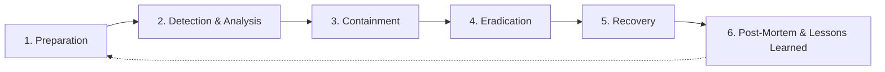

# Nexora — Security Incident Response Plan (S-IRP)

## 1. Executive Summary & Purpose

This Security Incident Response Plan (S-IRP) establishes the formal methodology, operational responsibilities, escalation matrices, and technical containment procedures for identifying, responding to, and recovering from security incidents affecting the Nexora multi-tenant SaaS platform.

Adherence to this plan ensures rapid containment, customer data protection, business continuity, and regulatory compliance (GDPR, FERPA, SOC 2).

---

## 2. Incident Severity Classification Matrix

| Severity Level | Definition | Impact Scope | Response SLA | Escalation Target |
| :---: | :--- | :--- | :---: | :--- |
| **SEV-1 (Critical)** | Active customer data breach, remote code execution (RCE), Supabase database compromise, mass exfiltration, or complete platform unavailability. | Multi-tenant impact; PII / data exposure | **< 15 minutes** | CTO, Lead Security Architect, Legal / Compliance |
| **SEV-2 (High)** | Broken Object-Level Authorization (BOLA) leak, horizontal/vertical privilege escalation, bypass of rate limits causing financial burn, unauthorized admin access. | Single-tenant impact; elevated risk | **< 1 hour** | Lead Security Architect, Senior Backend Engineers |
| **SEV-3 (Medium)** | Localized prompt injection attempt, elevated rate-limit violations, non-exploitable configuration defect, single-user credential stuffing. | No data exposure; mitigated by defenses | **< 4 hours** | On-Call Security Engineer |
| **SEV-4 (Low)** | Informational scan, isolated failed login, benign magic-byte file rejection. | Zero impact | **< 24 hours** | DevSecOps Daily Review |

---

## 3. Incident Response Lifecycle (NIST SP 800-61)

### Phase 1: Preparation
- Continuous audit logging enabled (`api/app/core/audit.py`).
- Request tracing and correlation enabled (`X-Request-ID` via `CorrelationIdMiddleware`).
- Secret rotation runbooks validated (`SECRETS_MANAGEMENT_POLICY.md`).
- Multi-tier rate limiting active across API surfaces.

### Phase 2: Detection & Analysis
- Audit events emitted to log collectors with standardized fields:
  - `event_type` (`BOLA_ACCESS_DENIED`, `AUTH_LOGIN_FAILURE`, `CODE_SECURITY_VIOLATION`, etc.)
  - `correlation_id` to trace end-to-end request context across edge and backend.
  - `user_id` and `client_ip` (normalized across Cloudflare/Vercel proxies).
- Threshold alerts trigger notifications when error or violation velocity exceeds baselines (e.g., > 10 BOLA denials within 5 minutes).

### Phase 3: Containment
- **Session Revocation:** Instantly invalidate compromised user sessions by revoking JTI in `TokenBlocklist` via `/api/v1/auth/logout`.
- **IP / Network Blocking:** Add offending client IP to Vercel Firewall / Cloudflare WAF blocklist.
- **Emergency Secret Rotation:** Follow runbooks in `SECRETS_MANAGEMENT_POLICY.md` if credentials (JWT secret, DB passwords) are suspected compromised.
- **Subsystem Isolation:** Disable host code execution or rate-limit AI gateways to prevent financial loss.

### Phase 4: Eradication
- Identify root cause in application logic or configuration.
- Implement tested patch in working branch `security/enterprise-hardening`.
- Run automated security test suite (`api/tests/test_security_phase*.py`) to verify zero regressions.

### Phase 5: Recovery
- Deploy patch through verified CI/CD pipeline to Vercel.
- Verify platform health via `/api/v1/health` and end-to-end user workflows.
- Monitor audit logs closely for 48 hours for recurrence or secondary attacker activity.

### Phase 6: Post-Mortem & Lessons Learned
- Conduct post-mortem meeting within 72 hours of incident closure.
- Document Root Cause Analysis (RCA), timeline of events, detection delay, containment effectiveness, and corrective actions.
- Update threat models and automated test suites to prevent regression.

---

## 4. Emergency Contacts & Roles

| Role | Primary Responsibility |
| :--- | :--- |
| **Incident Commander (IC)** | Coordinates response, approves containment decisions, manages timeline. |
| **Technical Lead** | Performs code inspection, debugging, patch creation, and technical verification. |
| **Communications Lead** | Manages communications to affected users, regulators, and stakeholders. |
