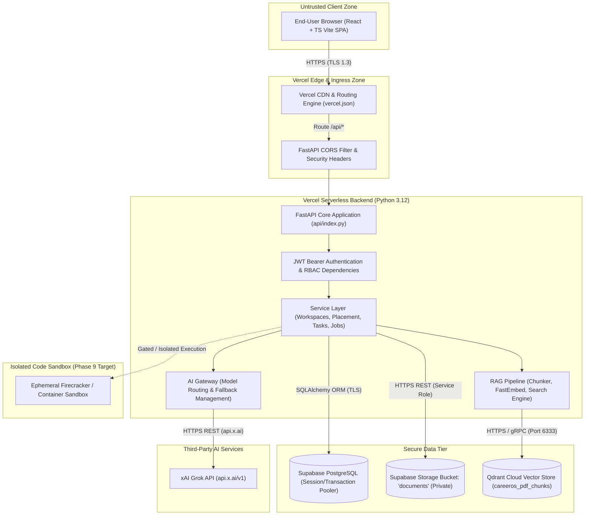

# NEXORA — Enterprise-Grade SaaS Security Architecture
## Document 09: Master Security Architecture Specification

**Document Code:** NEXORA-ARCH-001  
**Target:** Nexora SaaS Application (`https://nexoraos.space`)  
**Repository:** `KalpataruDash2005/Nexux`  
**Working Branch:** `security/enterprise-hardening`  
**Classification:** Confidential — Security Engineering Architecture  

---

## 1. System Overview & Architecture Topology

Nexora is an autonomous career readiness, task planning, and academic intelligence SaaS platform. The system operates as a hybrid serverless application deployed across Vercel Edge/Serverless, Supabase PostgreSQL, Qdrant Cloud, and xAI Grok.



---

## 2. Security Zones & Network Boundaries

| Zone Identifier | Zone Name | Components | Threat Level | Permitted Communication |
| :--- | :--- | :--- | :---: | :--- |
| **SZ-01** | **Client Zone** | Web browsers, mobile web clients. | Untrusted | Ingress via HTTPS (TLS 1.3) to Vercel Edge. |
| **SZ-02** | **Edge & Ingress Zone** | Vercel CDN, route dispatchers, static assets. | Semi-Trusted | Serves SPA bundle, proxies `/api/*` to serverless function. |
| **SZ-03** | **Application Compute Zone** | FastAPI backend in Vercel Serverless runtime. | Trusted | Evaluates JWTs, enforces RBAC/ABAC, executes business logic. |
| **SZ-04** | **Data Tier** | Supabase PostgreSQL, Supabase Storage, Qdrant Cloud. | High Security | Accessible only via authenticated credentials over TLS. |
| **SZ-05** | **AI Processing Tier** | xAI Grok provider (`api.x.ai/v1`). | External Trusted Partner | Accepts structured prompts, returns generated text/JSON. |
| **SZ-06** | **Execution Sandbox Zone** | Ephemeral microVM container runtime. | Untrusted Code Isolation | Zero network access, read-only FS, hard limits. |

---

## 3. Identity, Authentication & Session Architecture

### 3.1 Authentication Tokens & Cryptographic Verification
- **Token Type:** Stateless JSON Web Tokens (JWT).
- **Signing Algorithm:** HMAC-SHA256 (`HS256`).
- **Signature Secret:** Cryptographically random 256-bit secret loaded strictly from `JWT_SECRET` environment variable.
- **Token Claims Payload:**
  ```json
  {
    "sub": "user@example.com",
    "iat": 1730894400,
    "exp": 1730980800,
    "role": "STUDENT",
    "jti": "d3b07384-d113-4a1a-a829-19962a32c256"
  }
  ```
- **Token Expiration:** 24 hours (86,400,000 ms), with roadmap migration to 15-minute access tokens + rotating refresh tokens.

### 3.2 Credential Storage & Password Hashing
- **Hashing Algorithm:** BCrypt (`bcrypt.hashpw(password.encode('utf-8')[:72], bcrypt.gensalt(12))`).
- **Input Truncation:** 72-byte safe truncation matching BCrypt specification.
- **Salt Generation:** Secure pseudorandom per-user salt generated on every password registration or update.

---

## 4. Authorization & Multi-Tenant Access Control Model

Nexora implements a dual-layer access control model:
1. **Role-Based Access Control (RBAC):** Coarse-grained access governing module availability.
   - `STUDENT`: Normal student workflows (workspaces, PDF chat, coding practice, tasks, resumes, job applications).
   - `RECRUITER`: Job posting, candidate review, applicant status modification.
   - `ADMIN`: Platform diagnostics, feedback management, aptitude set curation, user audits.
2. **Attribute-Based Access Control / Ownership Verification (ABAC):** Fine-grained validation ensuring every database query and business transaction explicitly enforces tenant ownership:
   - `Workspace`: `workspace.owner_id == current_user.id`
   - `PdfDocument`: `doc.owner_id == current_user.id AND doc.workspace_id == workspace.id`
   - `Task`: `task.user_id == current_user.id`
   - `Job`: `job.posted_by_id == current_user.id` (Recruiter ownership)
   - `Application`: `app.student_id == current_user.id` (Candidate) OR `job.posted_by_id == current_user.id` (Hiring Recruiter)

---

## 5. End-to-End Sensitive Data Flows

### 5.1 Flow 1: Academic Document Upload & RAG Indexing
1. Student uploads PDF via `POST /api/v1/pdf-assistant/workspaces/{id}/documents`.
2. Backend validates `workspace.owner_id == current_user.id`.
3. Validates file extension (`.pdf`, `.txt`) and magic bytes (`%PDF-`).
4. Size checked against 4.5 MB serverless payload ceiling.
5. Storage key generated via `f"{workspace.id}_{uuid.uuid4().hex}"`.
6. Raw binary saved to private Supabase bucket `documents`.
7. `PDFExtractor` extracts plain text in-memory via `pypdf`.
8. `TextChunker` creates 1,200-character chunks with 150-character overlap.
9. `EmbeddingService` generates 384-dimensional dense vectors via `fastembed`.
10. Vectors upserted to Qdrant collection with payload: `{workspaceId, documentId, ownerId, text}`.

### 5.2 Flow 2: Algorithmic Code Evaluation
1. Student submits code via `POST /api/v1/placement/coding/{id}/run`.
2. Backend validates `session.owner_id == current_user.id`.
3. Code syntax validated via deterministic AST parse (no code execution).
4. Code executed in dedicated isolated ephemeral sandbox (microVM / container with zero network, non-root user, 3-second timeout).
5. Output compared against expected outputs; hidden test cases remain masked.
6. Execution metrics and evaluation returned to student.

---

## 6. Defense-in-Depth Strategy Matrix

```text
┌────────────────────────────────────────────────────────────────────────┐
│                   NEXORA DEFENSE-IN-DEPTH MATRIX                       │
├─────────────────┬──────────────────────────────────────────────────────┤
│ 1. Perimeter    │ • Strict CORS regex (no arbitrary *.vercel.app)      │
│    Defense      │ • HTTP Security Headers (HSTS, CSP, nosniff, DENY)   │
│                 │ • Vercel Edge DDoS mitigation & HTTPS enforcement    │
├─────────────────┼──────────────────────────────────────────────────────┤
│ 2. Ingress &    │ • Rate limiting (Auth, AI routes, Code execution)    │
│    Validation   │ • File size & MIME magic byte validation             │
│                 │ • Pydantic schema validation & input length bounds   │
├─────────────────┼──────────────────────────────────────────────────────┤
│ 3. Identity &   │ • Server-side role enforcement (No self-admin reg)   │
│    Access       │ • Mandatory 256-bit JWT secret                       │
│                 │ • Strict BOLA/IDOR ownership checks on every entity  │
├─────────────────┼──────────────────────────────────────────────────────┤
│ 4. Execution    │ • Elimination of raw host subprocess code execution  │
│    Isolation    │ • Dedicated ephemeral microVM sandboxes              │
├─────────────────┼──────────────────────────────────────────────────────┤
│ 5. Data &       │ • Supabase PostgreSQL Row Level Security (RLS)       │
│    Storage      │ • Private Supabase Storage bucket ('documents')      │
│                 │ • Qdrant vector payload tenant isolation             │
├─────────────────┼──────────────────────────────────────────────────────┤
│ 6. AI Safety    │ • Structural prompt tagging (<untrusted_content>)    │
│                 │ • System instruction reinforcement against overrides │
│                 │ • Strict schema enforcement on model outputs         │
├─────────────────┼──────────────────────────────────────────────────────┤
│ 7. Audit &      │ • Correlation IDs on every request                   │
│    Monitoring   │ • Masked error feedback (No database/stack leaks)    │
│                 │ • Structured security event audit logging            │
└─────────────────┴──────────────────────────────────────────────────────┘
```
