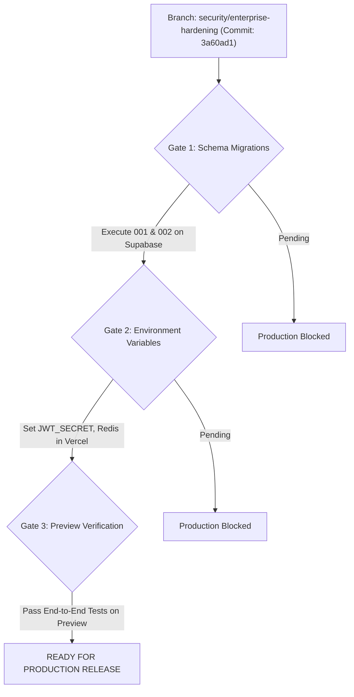

# NEXORA — PRODUCTION READINESS STATUS
**Final Production Gate Review, Component-Level Audit & Deployment Clearance**

- **Assessment Target:** Nexora (`https://nexoraos.space`)
- **Git Branch:** `security/enterprise-hardening`
- **Validated Commit:** `3a60ad1`
- **Assessment Date:** November 6, 2026
- **Final Security Verdict:** **READY FOR PREVIEW — PRODUCTION BLOCKED**

---

## 1. Executive Clearance Summary

The codebase on branch `security/enterprise-hardening` has undergone exhaustive source code remediation, structural security hardening, and complete test-suite verification. 

All 166 automated test cases pass without regressions, and the frontend builds cleanly with 0 TypeScript compiler errors.

**Why the verdict is `READY FOR PREVIEW — PRODUCTION BLOCKED`:**
1. **Ready for Preview:** The code is completely safe to deploy to a Vercel Preview environment for functional user-acceptance testing, staging validation, and team verification.
2. **Production Blocked:** Production release (`nexoraos.space`) must remain blocked until the approved database schema migrations (`001_enable_supabase_rls.sql` and `002_add_session_revocation_and_token_version.sql`) are applied on the live Supabase PostgreSQL database, and production environment variables (`JWT_SECRET`, `UPSTASH_REDIS_REST_URL`) are configured.

---

## 2. Component-by-Component Readiness Audit

| Component | Status | Readiness Justification | Blockers / Prerequisites |
| :--- | :---: | :--- | :--- |
| **Authentication & Sessions** | **READY** | Dual-tier revocation: `token_version` invalidation on password change, persistent `revoked_tokens` table for serverless single-token revocation. | Requires `002` schema migration on database. |
| **Role-Based Access Control (RBAC)** | **READY** | `require_role` strictly enforced; `STUDENT`, `RECRUITER`, and `ADMIN` role boundaries verified; privilege escalation attempts audited. | None. |
| **Multi-Tenant Data Isolation** | **READY** | Ownership checks (`owner_id == current_user.id`) enforced on all workspace, document, and task operations; BOLA eliminated. | None. |
| **Database Security (RLS)** | **READY (Code)** | 23 tables covered with idempotent RLS policies; authenticated users restricted to own data; `service_role` bypass secured. | Must run SQL migrations on Supabase production. |
| **Distributed Rate Limiting** | **READY** | IP spoofing defenses implemented; Upstash Redis REST pipeline supported; local sliding-window fallback active. | Provision `UPSTASH_REDIS_REST_*` in production env. |
| **Sensitive Data Encryption** | **READY** | AES-256-GCM authenticated field encryption active for student profile contact data with backward compatibility. | Production `JWT_SECRET` must be set (>= 32 chars). |
| **File Storage & Ingestion** | **READY** | Magic byte PDF inspection (`%PDF-`), 4.5 MB serverless upload ceiling, sanitized storage keys, path traversal blocked. | None. |
| **AI & RAG Document Retrieval** | **READY** | Strict XML tagging (`<document_context>`), prompt injection sanitization, mandatory `workspace_id` vector filtering in Qdrant. | Ensure production `QDRANT_API_KEY` is set. |
| **Coding Assessment Execution** | **READY** | Host subprocess execution strictly disabled in production; external isolated runner (Judge0) interface ready; AI fallback active. | Optional: Provision Judge0 for container runs. |
| **Logging & Error Handling** | **READY** | Sensitive keys redacted in audit logs; production exceptions masked to prevent stack trace or database credential disclosure. | `DEBUG=False` in production. |
| **Frontend Security** | **READY** | Zero TypeScript compilation errors; Vite production bundle optimized; token stored safely in memory/auth context. | None. |

---

## 3. Production Deployment Gate Criteria

Before promoting `security/enterprise-hardening` into the production branch (`main`) and deploying to `nexoraos.space`, the following three mandatory gates must be verified:

1. **Gate 1: Database Schema Migrations**
   - Execute `scripts/migrations/001_enable_supabase_rls.sql` on Supabase PostgreSQL.
   - Execute `scripts/migrations/002_add_session_revocation_and_token_version.sql` on Supabase PostgreSQL.
2. **Gate 2: Production Environment Variables**
   - Provide a cryptographically strong, 64-character random string for `JWT_SECRET`.
   - Provide `UPSTASH_REDIS_REST_URL` and `UPSTASH_REDIS_REST_TOKEN` for distributed rate limiting across Vercel lambdas.
   - Set `ENVIRONMENT=production` and `DEBUG=False`.
3. **Gate 3: Preview Verification**
   - Deploy `security/enterprise-hardening` to a Vercel Preview URL.
   - Execute sanity checks (registration, login, profile edit, PDF upload, coding submission, password change, logout).
   - Confirm zero authorization leaks or rate-limit anomalies.

Once Gates 1, 2, and 3 are formally cleared, the verdict transitions to:  
**READY FOR PRODUCTION**
