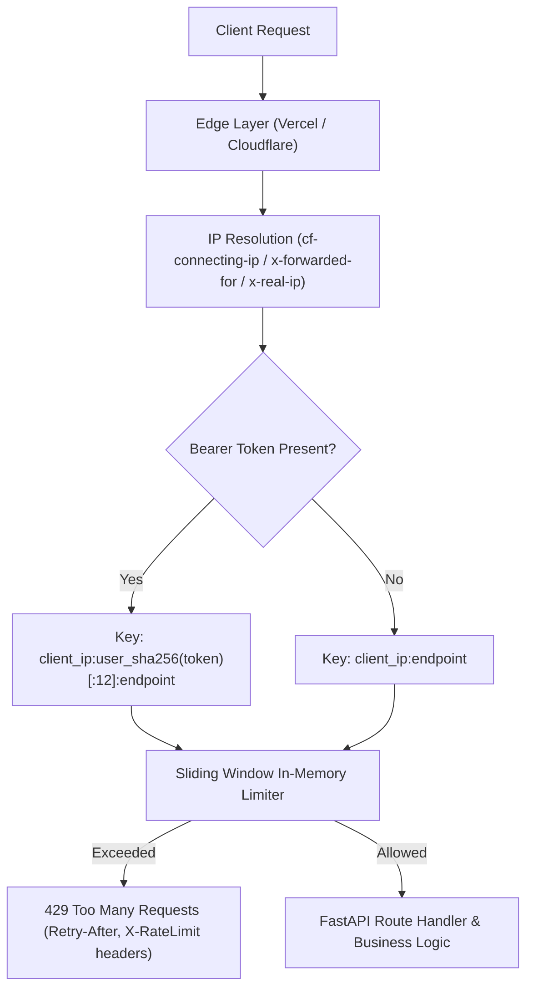

# Nexora — Rate Limiting & SaaS Abuse Prevention Architecture

## 1. Overview & Abuse Threat Model

As a multi-tenant AI-driven SaaS application, Nexora is vulnerable to several categories of malicious abuse:
1. **Denial-of-Wallet (DoW) Attacks:** Malicious actors or runaway clients generating excessive requests to upstream LLM providers (xAI Grok) or vector search infrastructure (Qdrant), resulting in exorbitant API bills.
2. **Credential Stuffing & Brute Force:** Automated credential guessing against `/api/v1/auth/login` and account registration spamming against `/api/v1/auth/register`.
3. **Compute Exhaustion:** Flooding heavy compilation or code evaluation endpoints (`/api/v1/placement/coding/*`) and PDF ingestion pipelines (`/api/v1/pdf-assistant/*`).
4. **Scraping & Exfiltration:** Automated harvesting of student profiles, recruiter job postings, and aptitude questions.

---

## 2. Multi-Tier Rate Limiting Architecture

Nexora deploys a multi-tier defense architecture to protect compute and financial resources:



### 2.1 Reverse Proxy & IP Header Normalization
Because Nexora runs on serverless edge nodes behind Vercel and Cloudflare, direct socket IP (`request.client.host`) reflects internal load balancers. Nexora's `get_client_identifier()` inspects:
1. `cf-connecting-ip` (Cloudflare origin IP)
2. `x-forwarded-for` (first comma-separated client IP)
3. `x-real-ip` (standard reverse proxy IP)
4. Socket fallback (`request.client.host`)

### 2.2 NAT & Corporate Proxy Collision Avoidance
To prevent different legitimate users sharing an institutional Wi-Fi or corporate NAT from blocking each other, authenticated requests append a truncated SHA-256 hash of their Bearer token (`:user_<hash>`), providing per-user quotas alongside IP quotas.

---

## 3. Tiered Endpoint Quota Matrix

Rate limits are strictly enforced on high-risk and resource-intensive endpoints:

| Endpoint Path | Method | Purpose | Rate Limit (Requests / Window) | Rationale |
| :--- | :---: | :--- | :---: | :--- |
| `/api/v1/auth/register` | `POST` | User Registration | 20 req / 60s | Sybil attack & account spam mitigation |
| `/api/v1/auth/login` | `POST` | User Login | 30 req / 60s | Credential stuffing & brute-force defense |
| `/api/v1/auth/change-password` | `POST` | Password Change | 10 req / 60s | Account takeover defense |
| `/api/v1/pdf-assistant/.../documents` | `POST` | PDF Upload & Vector Indexing | 10 req / 60s | CPU/storage and vector indexing protection |
| `/api/v1/pdf-assistant/.../chat` | `POST` | RAG Q&A | 25 req / 60s | Denial-of-wallet mitigation on xAI Grok |
| `/api/v1/pdf-assistant/.../stream` | `POST` | Streaming RAG Q&A | 25 req / 60s | Denial-of-wallet mitigation on xAI Grok |
| `/api/v1/placement/resume/analyze` | `POST` | AI Resume Parsing | 10 req / 60s | LLM token budget control |
| `/api/v1/placement/sessions/.../messages` | `POST` | Live AI Interview Chat | 30 req / 60s | Conversational AI budget enforcement |
| `/api/v1/placement/coding/.../run` | `POST` | Visible Code Execution | 20 req / 60s | Code execution resource bounding |
| `/api/v1/placement/coding/.../submit` | `POST` | Full Code Evaluation | 10 req / 60s | Exhaustive test suite & LLM analysis control |
| `/api/v1/tasks/ai-plan` | `POST` | AI Task Decomposition | 10 req / 60s | Planning LLM prompt quota |
| `/api/v1/tasks/assistant` | `POST` | Task Assistant Chat | 30 req / 60s | General task AI chat quota |

---

## 4. Standard Response Headers & Error Specifications

When a client breaches rate limits, Nexora responds with HTTP 429 (`RFC 6585` compliant) including:
```http
HTTP/1.1 429 Too Many Requests
Content-Type: application/json
Retry-After: 60
X-RateLimit-Limit: 10
X-RateLimit-Remaining: 0
X-RateLimit-Reset: 60

{
  "detail": "Rate limit exceeded. Maximum 10 requests per 60 seconds."
}
```

---

## 5. Distributed Scalability Roadmap (Upstash / Redis)

For production deployments scaling across multiple serverless regions:
- The current sliding-window in-memory limiter provides per-node protection with automatic 5-minute memory sweep.
- When multi-region state synchronization is required, `limiter` can be swapped with `@upstash/ratelimit` or Redis sliding-window counter using the same `client_key` format.
