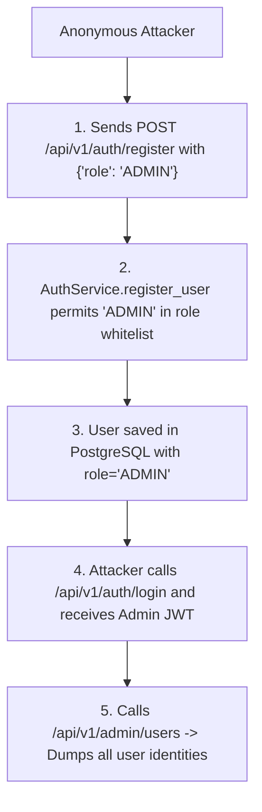
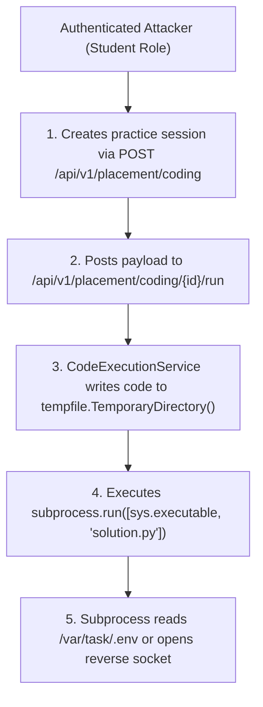
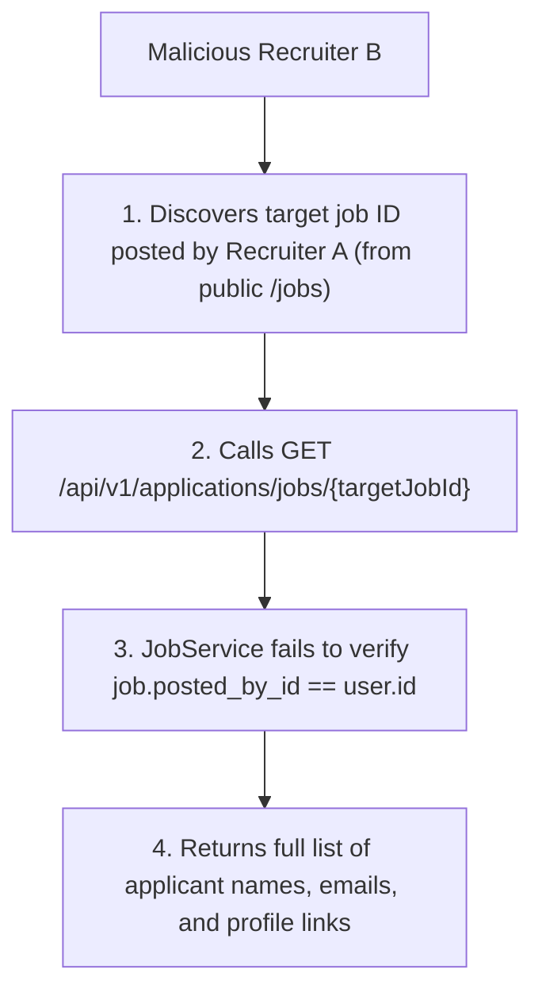
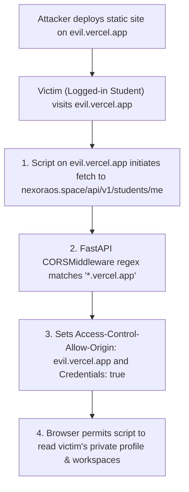

# NEXORA — Enterprise-Grade SaaS Security Transformation
## Document 12: Comprehensive Threat Model (STRIDE Methodology)

**Document Code:** NEXORA-THREAT-001  
**Target:** Nexora SaaS Application (`https://nexoraos.space`)  
**Repository:** `KalpataruDash2005/Nexux`  
**Working Branch:** `security/enterprise-hardening`  
**Classification:** Confidential — Security Engineering Threat Model  

---

## 1. Threat Modeling Methodology & Threat Actor Profiles

This threat model applies the **STRIDE** methodology (Spoofing, Tampering, Repudiation, Information Disclosure, Denial of Service, Elevation of Privilege) in conjunction with architectural threat trees to map adversary capabilities against Nexora assets.

### Threat Actor Profiles

| Threat Actor | Motivation | Capabilities | Entry Points |
| :--- | :--- | :--- | :--- |
| **TA-01: Anonymous External Attacker** | Financial gain, disruption, credential harvesting. | Automated script scanning, public HTTP requests, malicious file uploads. | `/api/v1/auth/*`, `/api/v1/jobs`, `/feedback`, public web pages. |
| **TA-02: Malicious Student Tenant** | Cheating on coding/interview tests, data exfiltration, lateral movement. | Valid authenticated session, code execution submissions, PDF uploads. | `/api/v1/placement/*`, `/api/v1/workspaces/*`, `/api/v1/tasks/*`. |
| **TA-03: Malicious Recruiter Tenant** | Competitor intelligence gathering, poaching talent, sabotage. | Valid recruiter session, job posting tools, applicant review endpoints. | `/api/v1/jobs`, `/api/v1/applications/*`. |
| **TA-04: Malicious Third-Party Origin (Vercel Tenant)** | Cross-origin session theft, authenticated API proxying. | Free Vercel website hosting, browser script execution on victim. | Client browser cross-origin requests matching `*.vercel.app`. |
| **TA-05: Compromised Dependency / Supply Chain** | Silent backdoor injection, secret extraction. | Code execution within build pipeline or serverless runtime. | Python `requirements.txt`, npm `package.json`. |

---

## 2. STRIDE Analysis Across Nexora Architecture

```text
┌────────────────────────────────────────────────────────────────────────┐
│                        STRIDE THREAT BREAKDOWN                         │
├─────────────────┬──────────────────────────────────────────────────────┤
│ Spoofing        │ • Forging JWT tokens via known/default secret        │
│                 │ • Impersonating candidates via URL token injection   │
├─────────────────┼──────────────────────────────────────────────────────┤
│ Tampering       │ • Submitting hostile Python code to alter host files │
│                 │ • Modifying hiring statuses of other recruiters' jobs│
├─────────────────┼──────────────────────────────────────────────────────┤
│ Repudiation     │ • Lack of audit logs for admin deletions/mutations   │
│                 │ • Absence of immutable audit trails for applications │
├─────────────────┼──────────────────────────────────────────────────────┤
│ Information     │ • Exfiltrating competitor candidate emails via BOLA  │
│ Disclosure      │ • Cross-student vector search chunk retrieval        │
│                 │ • CORS leakage to third-party *.vercel.app sites     │
├─────────────────┼──────────────────────────────────────────────────────┤
│ Denial of       │ • Unlimited xAI Grok token consumption (billing DoS) │
│ Service         │ • Infinite execution loops in host Python subprocess │
├─────────────────┼──────────────────────────────────────────────────────┤
│ Elevation of    │ • Registering with role="ADMIN" on public endpoint   │
│ Privilege       │ • Breaking out of subprocess to host system privileges│
└─────────────────┴──────────────────────────────────────────────────────┘
```

---

## 3. High-Impact Attack Trees & Exploit Scenarios

### Scenario 1: Unauthenticated Administrative Takeover (NEX-VULN-001)

- **Probability:** High  
- **Impact:** Critical (Complete administrative compromise)  
- **Countermeasure:** Remove `"ADMIN"` from public registration schema and validator; mandate CLI/migration admin provisioning.

---

### Scenario 2: Remote Code Execution & Host Sandbox Escape (NEX-VULN-002)

- **Probability:** High  
- **Impact:** Critical (Host filesystem and network compromise)  
- **Countermeasure:** Block raw host subprocess execution immediately; migrate to isolated microVM / container execution service.

---

### Scenario 3: Cross-Tenant Candidate Intelligence Theft via BOLA (NEX-VULN-003)

- **Probability:** High  
- **Impact:** High (Mass PII breach across competing companies)  
- **Countermeasure:** Verify `job.posted_by_id == user.id` before executing repository query.

---

### Scenario 4: Cross-Origin Data Theft via Over-Permissive CORS (NEX-VULN-004)

- **Probability:** High  
- **Impact:** High (Confidentiality breach of student accounts)  
- **Countermeasure:** Restrict CORS regex strictly to `nexoraos.space` and exact project preview URL prefixes.

---

## 4. Threat Countermeasure & Verification Mapping

| Threat ID | Threat Description | Primary Mitigation | Verification Test |
| :--- | :--- | :--- | :--- |
| **TH-01** | Public Admin Role Escalation | Server-side role whitelist restricting registration to `STUDENT` & `RECRUITER`. | Automated test asserting HTTP 400 on `role="ADMIN"`. |
| **TH-02** | Host RCE via Code Sandbox | Disabled host subprocess execution in serverless; dedicated sandbox runner. | Verify subprocess spawning is blocked in production mode. |
| **TH-03** | Recruiter Application BOLA | Strict `job.posted_by_id == user.id` ownership check. | Multi-tenant test verifying HTTP 403 on foreign job access. |
| **TH-04** | Arbitrary Vercel CORS Theft | Explicit origin whitelist with anchored regex. | Preflight check asserting `evil.vercel.app` is rejected. |
| **TH-05** | Fallback to Default JWT Secret | Mandatory `JWT_SECRET` validation on startup (`min_length=32`). | Startup unit test verifying app crashes if secret is missing/default. |
| **TH-06** | Cross-Student Vector Leakage | Enforce workspace ownership check before calling `rag_pipeline.search_context`. | Test asserting HTTP 404 when querying unowned workspace search. |
| **TH-07** | Supabase PostgREST Table Dumping | `ENABLE ROW LEVEL SECURITY` across all public PostgreSQL tables. | Direct PostgREST query test with `anon` key asserting empty/denied. |
| **TH-08** | Indirect Prompt Injection | Structural `<untrusted_content>` tags and prompt defense directives. | Automated adversarial evaluation test cases. |
